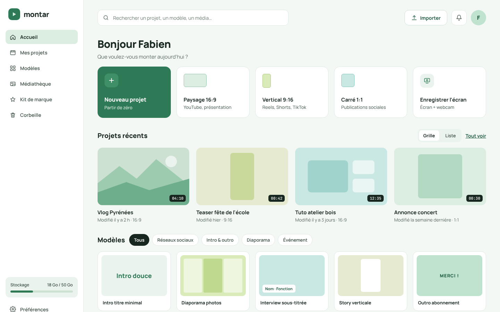
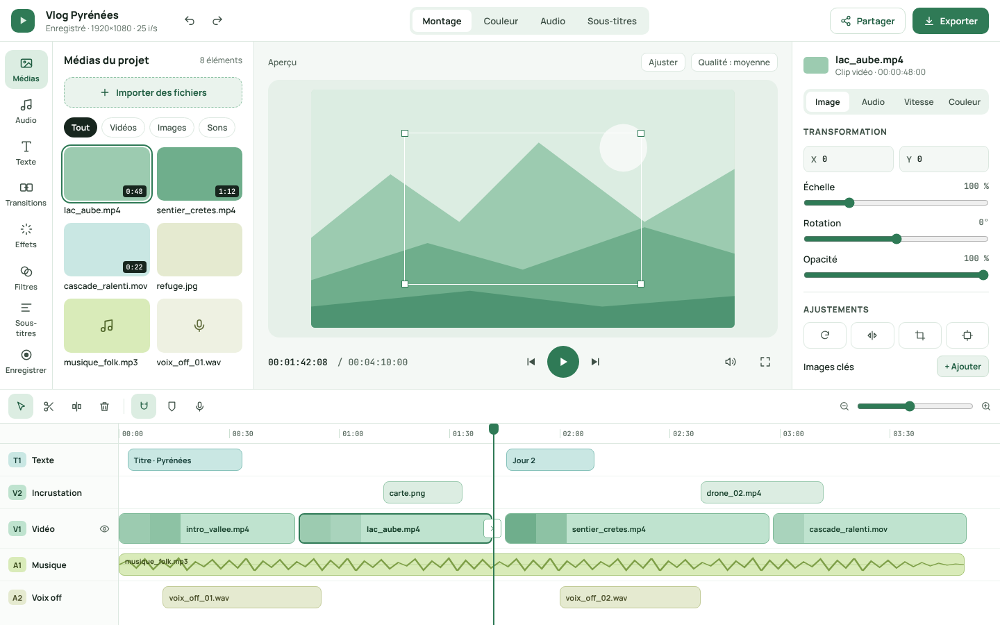
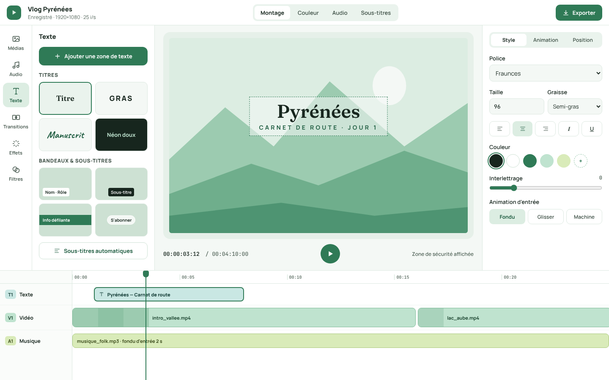
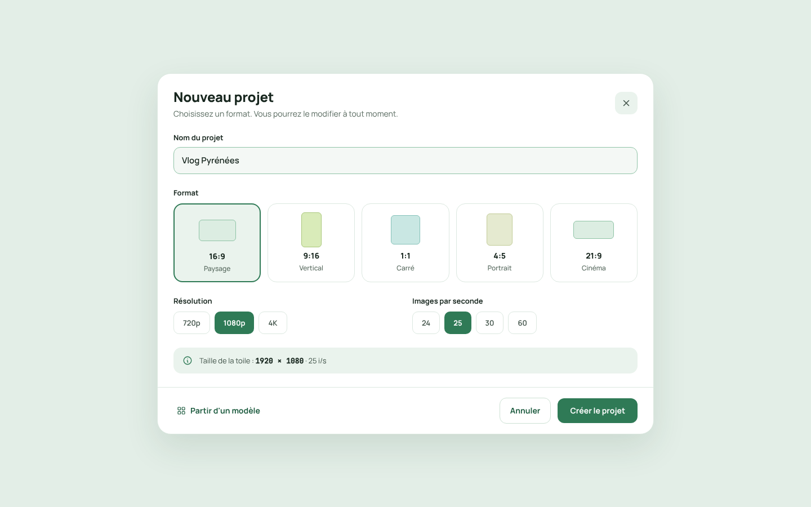
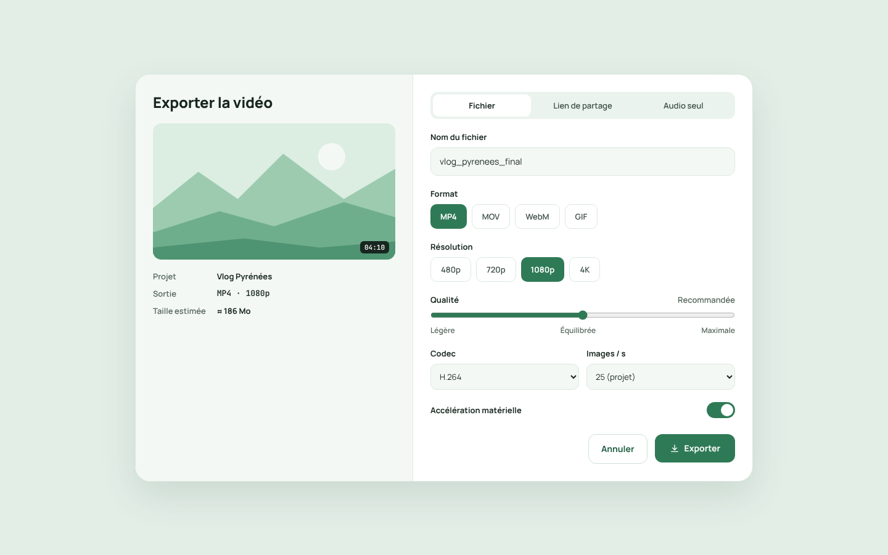
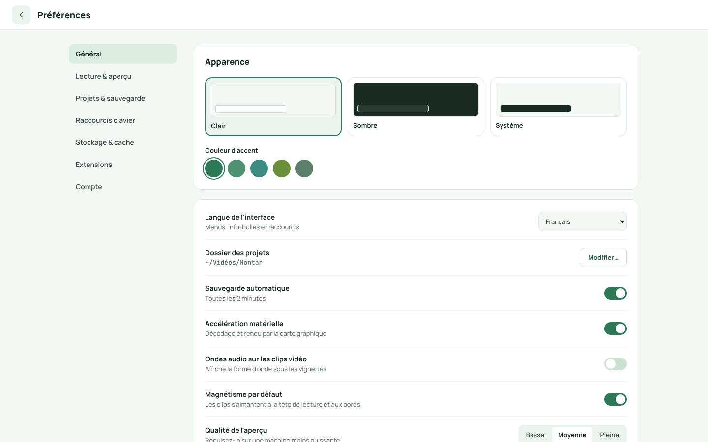
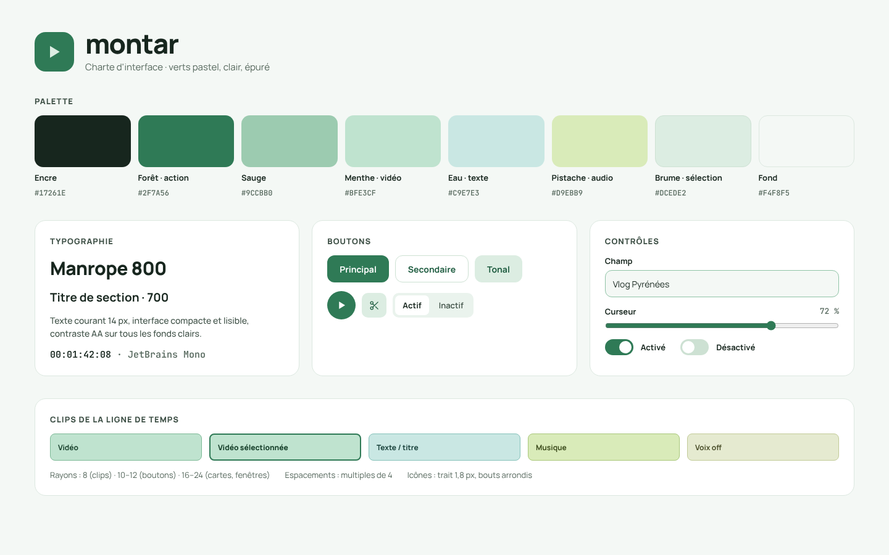

# Cahier des charges — montar

> Logiciel de montage vidéo de bureau, simple et local, extensible par modules.
> Version du document : 0.2 — 21/10/2026
>
> | Version | Modifications |
> |---------|---------------|
> | 0.1 | Brouillon initial |
> | 0.2 | Décisions actées (§8) : licence GPLv3, nom « montar », développement en Python, pas de bibliothèque de ressources fournie, cibles Debian / Ubuntu / Mint. Intégration des maquettes d'interface et de la charte graphique (§6). |

---

## 1. Contexte et objectifs

### 1.1 Contexte
Les éditeurs vidéo « grand public » comme Microsoft Clipchamp offrent une prise en main rapide,
mais imposent souvent un compte en ligne, un stockage cloud ou un fonctionnement dans le navigateur,
et ne sont pas disponibles nativement sous Linux.

### 1.2 Objectifs
| # | Objectif |
|---|----------|
| O1 | Proposer un éditeur vidéo **simple**, au niveau fonctionnel de Clipchamp (fonctions de base). |
| O2 | Fonctionner **100 % en local** : aucun compte, aucune connexion obligatoire, aucun envoi de média vers un drive. |
| O3 | Cibler **Linux en premier** — Debian, Ubuntu, Linux Mint (paquet `.deb`) —, puis **Windows** (installeur). |
| O4 | Être **extensible par modules** (effets, transitions, formats d'export, outils) écrits en Python, sans recompiler ni réinstaller l'application. |
| O5 | Fournir dès la v1 un **effet Timelapse** applicable à une **portion** d'une vidéo. |
| O6 | Logiciel **libre sous licence GPLv3**. |

### 1.3 Hors périmètre (v1)
- Montage collaboratif / temps réel à plusieurs.
- Stockage cloud intégré et liens de partage en ligne (l'utilisateur reste libre de travailler dans un dossier synchronisé, mais l'application ne l'exige pas).
- **Bibliothèque de ressources fournie** (musiques, sons, autocollants, fonds, vidéos d'illustration) : l'utilisateur importe ses propres médias. L'architecture doit permettre d'en ajouter une plus tard sous forme de module.
- Fonctions IA nécessitant un service en ligne.
- Compositing avancé (keying 3D, suivi de mouvement, étalonnage professionnel).
- Autres distributions Linux (Fedora, Arch, openSUSE…) et macOS : envisageables plus tard, l'architecture ne doit pas l'empêcher.

---

## 2. Utilisateurs cibles

- **Utilisateur occasionnel** : monte des vidéos de vacances, tutoriels, vidéos pour réseaux sociaux.
- **Créateur de contenu débutant** : besoin de titres, musique, sous-titres, export vertical (9:16).
- **Développeur / contributeur** : souhaite ajouter un module (effet, export) en Python via une API documentée.

Hypothèses : aucune compétence technique requise pour l'utilisateur final ; interface en français et en anglais dès la v1.

---

## 3. Exigences fonctionnelles

Priorités : **P1** = indispensable v1 · **P2** = souhaitable v1 · **P3** = versions ultérieures.
La colonne « Écran » renvoie aux maquettes du §6.

### 3.1 Écran d'accueil et gestion de projet
| ID | Exigence | Prio | Écran |
|----|----------|------|-------|
| F-PRJ-01 | Créer, ouvrir, enregistrer, « enregistrer sous » un projet dans un fichier local (`.montar`). | P1 | — |
| F-PRJ-02 | Dialogue « Nouveau projet » : nom, format (16:9 Paysage, 9:16 Vertical, 1:1 Carré, 4:5 Portrait, 21:9 Cinéma), résolution (720p, 1080p, 4K), images par seconde (24, 25, 30, 60), récapitulatif de la taille de la toile. Le format reste modifiable ensuite. | P1 | 04 |
| F-PRJ-03 | Sauvegarde automatique périodique (par défaut toutes les 2 min) + récupération après plantage. | P1 | 06 |
| F-PRJ-04 | Accueil : message de bienvenue, tuiles de création rapide (Nouveau projet, Paysage 16:9, Vertical 9:16, Carré 1:1), **projets récents** avec vignette, durée, date de modification et format ; affichage grille / liste. | P1 | 01 |
| F-PRJ-05 | Barre de recherche locale (projets, modèles, médias). | P2 | 01 |
| F-PRJ-06 | Navigation latérale : Accueil, Mes projets, Modèles, Médiathèque, Kit de marque, Corbeille, Préférences. | P1 (Accueil, Mes projets, Médiathèque, Corbeille, Préférences) / P2 (Modèles) / P3 (Kit de marque) | 01 |
| F-PRJ-07 | **Corbeille** : un projet supprimé y reste jusqu'à vidage manuel (ou après 30 jours, réglable). | P2 | 01 |
| F-PRJ-08 | Indicateur d'**espace disque local** utilisé par montar (cache, proxys, sauvegardes) par rapport à l'espace libre du disque — et non un quota cloud. | P2 | 01 |
| F-PRJ-09 | Chaque projet a son **dossier** (`~/Vidéos/Montar/<nom>/` : fichier `.montar` et sous-dossier `medias/`) ; **tous les médias importés y sont copiés** (vidéos comprises), le fichier d'origine n'est jamais modifié. Le dossier se déplace ou se sauvegarde d'un bloc. Les projets plus anciens sont rangés dans leur dossier et leurs médias copiés à l'ouverture (voir D8). | P1 | — |
| F-PRJ-10 | Détection des médias manquants et outil de reliaison. | P1 | — |
| F-PRJ-11 | Annuler / Rétablir illimité (dans la limite de la session), boutons dans l'en-tête de l'éditeur. | P1 | 02 |
| F-PRJ-12 | **Modèles** : enregistrer un projet comme modèle et créer un projet à partir d'un modèle (« Partir d'un modèle »). Aucun modèle fourni n'est exigé ; quelques modèles minimaux de démonstration (intro titre, outro, story verticale) sont acceptés s'ils n'utilisent aucun média externe. | P2 | 01, 04 |
| F-PRJ-13 | **Kit de marque** : logos, couleurs, polices de l'utilisateur, réutilisables dans les projets. | P3 | 01 |
| F-PRJ-14 | Notifications locales (cloche) : export terminé, proxys prêts, erreur de module. | P2 | 01 |

### 3.2 Bibliothèque de médias
| ID | Exigence | Prio | Écran |
|----|----------|------|-------|
| F-MED-01 | Import par glisser-déposer, bouton « Importer » de l'accueil ou « Importer des fichiers » du panneau Médias : vidéo, audio, image. | P1 | 01, 02 |
| F-MED-02 | Formats d'entrée minimaux : MP4 (H.264/H.265), MOV, MKV, WebM, AVI ; MP3, WAV, AAC, FLAC, OGG ; JPG, PNG, WebP, GIF. | P1 | — |
| F-MED-03 | Panneau « Médias du projet » : vignettes, durée, nombre d'éléments, filtres Tout / Vidéos / Images / Sons. Aperçu au survol. | P1 | 02 |
| F-MED-04 | **Médiathèque** globale : médias déjà utilisés dans les projets, réutilisables (index local, aucun fichier copié). | P2 | 01 |
| F-MED-05 | Génération de **proxys** (copies basse résolution) pour les fichiers lourds (4K), en tâche de fond. | P2 | — |
| F-MED-06 | « Enregistrer l'écran » (écran + webcam) et voix off (micro), en local. | P1 (écran, avancé en J5) / P2 (voix off, cf. F-AUD-04) | 01, 02 |

### 3.3 Timeline (ligne de temps)
| ID | Exigence | Prio | Écran |
|----|----------|------|-------|
| F-TL-01 | Pistes multiples typées et nommées : Texte (T*n*), Vidéo / Incrustation (V*n*), Musique / Voix off (A*n*). Nombre non limité arbitrairement. | P1 | 02 |
| F-TL-02 | Ajout de clips par glisser-déposer depuis les panneaux. | P1 | 02 |
| F-TL-03 | Barre d'outils : sélection, ciseaux / **scinder** au curseur (raccourci `S`), scinder à la sélection, supprimer, magnétisme, marqueur, enregistrement voix off ; curseur de zoom. | P1 | 02 |
| F-TL-04 | Déplacer, rogner (poignées début/fin), dupliquer. | P1 | 02 |
| F-TL-05 | Suppression avec fermeture automatique de l'espace (« ripple delete »). | P1 | — |
| F-TL-06 | Magnétisme (aimantation aux bords des clips et à la tête de lecture), activable/désactivable, état par défaut réglable. | P1 | 02, 06 |
| F-TL-07 | Zoom de la timeline, défilement, « ajuster à la fenêtre ». | P1 | 02 |
| F-TL-08 | Sélection d'une **plage** (point d'entrée / point de sortie) sur un clip — utilisée notamment par le Timelapse. | P1 | — |
| F-TL-09 | Masquer (œil) / verrouiller / couper le son d'une piste. | P2 | 02 |
| F-TL-10 | Formes d'onde sur les clips audio ; option d'affichage sous les clips vidéo. | P1 | 02, 06 |
| F-TL-11 | Marqueurs nommés. | P2 | 02 |
| F-TL-12 | Code couleur des clips conforme à la charte (§6.2) ; clip sélectionné mis en évidence par une bordure. | P1 | 07 |

### 3.4 Lecteur / prévisualisation
| ID | Exigence | Prio | Écran |
|----|----------|------|-------|
| F-PRV-01 | Lecture temps réel de la timeline avec son, en résolution réduite si nécessaire. | P1 | 02 |
| F-PRV-02 | Timecode `hh:mm:ss:ii` (police à chasse fixe), précédent / lecture / suivant, volume, plein écran. Raccourcis J/K/L, espace = lecture/pause, flèches = image par image. | P1 | 02 |
| F-PRV-03 | Qualité d'aperçu : Basse, Moyenne, Pleine (défaut réglable dans les préférences). Bouton « Ajuster » (zoom de l'aperçu). | P1 | 02, 06 |
| F-PRV-04 | Manipulation directe dans l'aperçu : poignées pour déplacer / redimensionner / pivoter un clip, un texte, une image. | P1 | 02, 03 |
| F-PRV-05 | Affichage optionnel de la **zone de sécurité** (titres). | P2 | 03 |

### 3.5 Inspecteur et édition des clips (équivalent Clipchamp)
L'inspecteur (panneau de droite) affiche le nom, le type et la durée du clip sélectionné, et des onglets **Image / Audio / Vitesse / Couleur** (vidéo) ou **Style / Animation / Position** (texte).

| ID | Exigence | Prio | Écran |
|----|----------|------|-------|
| F-EDT-01 | **Transformation** : position X/Y, échelle, rotation, opacité (champs numériques + curseurs). | P1 | 02 |
| F-EDT-02 | **Ajustements** : rotation 90°, retournement horizontal/vertical, recadrage (crop), ajuster / remplir / étirer. | P1 | 02 |
| F-EDT-03 | Onglet **Vitesse** : vitesse constante (0,1× à 16×), lecture inversée, accès à l'effet **Timelapse** (§3.9). | P1 (vitesse, Timelapse) / P2 (inversée) | 02 |
| F-EDT-04 | Onglet / mode **Couleur** : luminosité, contraste, saturation, température, exposition. | P1 | 02 |
| F-EDT-05 | Panneau **Filtres** : filtres prédéfinis (noir et blanc, sépia, vintage, froid, chaud…) avec intensité. | P1 | 02 |
| F-EDT-06 | Fondu d'entrée / de sortie (vidéo et audio). | P1 | — |
| F-EDT-07 | Panneau **Effets** : flou, vignettage, netteté, zoom lent (« Ken Burns ») sur image. | P2 | 02 |
| F-EDT-08 | Incrustation d'image / vidéo (picture-in-picture) via pistes superposées. | P1 | 02 |
| F-EDT-09 | Image fixe (« freeze frame ») à la position du curseur. | P2 | — |
| F-EDT-10 | **Images clés** (bouton « + Ajouter ») sur position, échelle, rotation, opacité. | P2 | 02 |
| F-EDT-11 | Fond vert (chroma key) basique. | P3 | — |
| F-EDT-12 | Stabilisation vidéo (traitement local). | P3 | — |

### 3.6 Transitions
| ID | Exigence | Prio | Écran |
|----|----------|------|-------|
| F-TRN-01 | Panneau **Transitions** : fondu enchaîné, fondu au noir/blanc, glissement, balayage, zoom ; application par glisser-déposer entre deux clips adjacents. | P1 | 02 |
| F-TRN-02 | Durée réglable par glisser ou saisie. | P1 | — |

### 3.7 Texte et titres
| ID | Exigence | Prio | Écran |
|----|----------|------|-------|
| F-TXT-01 | Panneau **Texte** : « Ajouter une zone de texte » ; styles de **titres** (Titre, GRAS, Manuscrit, Néon doux) ; **bandeaux & sous-titres** (Nom · Rôle, Sous-titre, Info défilante, S'abonner). Ces styles sont de simples préréglages (police, taille, couleurs, fond) et non des ressources externes. | P1 | 03 |
| F-TXT-02 | Onglet **Style** : police (polices système + polices embarquées, §6.2), taille, graisse, alignement gauche/centre/droite, italique, souligné, couleur (palette + personnalisée), interlettrage, contour, ombre, fond. | P1 | 03 |
| F-TXT-03 | Onglet **Animation** : animation d'entrée / de sortie (Fondu, Glisser, Machine à écrire). | P2 | 03 |
| F-TXT-04 | Onglet **Position** : position, alignement sur la toile, respect de la zone de sécurité. | P1 | 03 |
| F-TXT-05 | Mode **Sous-titres** : édition, import / export SRT ; sous-titres incrustés ou piste séparée à l'export. | P2 | 02 |
| F-TXT-06 | « Sous-titres automatiques » par transcription **locale** (module optionnel, modèle de reconnaissance vocale hors ligne, ex. Whisper). | P3 | 03 |

### 3.8 Audio
| ID | Exigence | Prio | Écran |
|----|----------|------|-------|
| F-AUD-01 | Volume par clip et par piste ; couper le son. | P1 | 02 |
| F-AUD-02 | Détacher l'audio d'un clip vidéo. | P1 | — |
| F-AUD-03 | Fondu audio d'entrée / de sortie (affiché sur le clip, ex. « fondu d'entrée 2 s »). | P1 | 03 |
| F-AUD-04 | Enregistrement de voix off depuis le micro (panneau Enregistrer / bouton micro de la timeline). | P2 | 02 |
| F-AUD-05 | Mode **Audio** : normalisation du volume ; atténuation automatique de la musique sous la voix (« ducking »). | P3 | 02 |
| F-AUD-06 | Réduction de bruit basique. | P3 | — |

### 3.9 Effet Timelapse (fonction par défaut, P1)

L'effet Timelapse doit permettre d'**accélérer fortement une partie seulement d'un clip**, le reste du clip conservant sa vitesse normale.

#### 3.9.1 Parcours utilisateur
1. L'utilisateur sélectionne un clip dans la timeline.
2. Il définit une plage : points d'entrée/sortie (`I` / `O`) ou glisser sur le clip, ou bien sélectionne directement un clip déjà scindé.
3. Il ouvre l'onglet **Vitesse** de l'inspecteur → **Timelapse** (ou clic droit → « Timelapse sur la sélection », ou panneau Effets).
4. Les réglages ci-dessous s'affichent dans l'inspecteur, avec aperçu immédiat.
5. Validation : le clip est découpé en 3 segments (avant / timelapse / après) ; le segment accéléré est visuellement repéré dans la timeline (badge « TL ×N »).

#### 3.9.2 Réglages
| Réglage | Valeurs | Défaut |
|---------|---------|--------|
| Mode de saisie | Facteur d'accélération **ou** durée cible du segment | Facteur |
| Facteur | ×2 à ×1000 (pas libre) ; préréglages ×4, ×8, ×16, ×32, ×60 | ×16 |
| Durée cible | ex. « 10 min → 15 s » ; le facteur est calculé | — |
| Méthode | **Échantillonnage** (une image sur N, rendu net et saccadé type timelapse classique) / **Fusion d'images** (moyenne de N images, rendu fluide avec traînées de mouvement) | Échantillonnage |
| Rampe de vitesse | Aucune / Douce en entrée / Douce en sortie / Les deux ; durée de rampe réglable (0–3 s) | Aucune |
| Audio du segment | Couper / Supprimer / Accélérer (hauteur préservée, utile seulement pour faibles facteurs) | Couper |
| Stabilisation de l'exposition | Lissage du scintillement de luminosité (« deflicker ») | Désactivé (P2) |

#### 3.9.3 Règles et contraintes
- L'effet est **non destructif** : il peut être modifié ou retiré à tout moment, le fichier source n'est jamais altéré.
- Plusieurs segments Timelapse peuvent coexister sur un même clip.
- La durée affichée dans la timeline est mise à jour en temps réel.
- Prévisualisation fluide jusqu'à ×64 en mode Échantillonnage sur la machine de référence ; au-delà, ou en mode Fusion, un **pré-calcul en tâche de fond** (cache) est autorisé avec barre de progression.
- Les transitions et le texte placés sur le segment s'appliquent normalement.
- Retirer l'effet propose de « fusionner » les segments pour retrouver le clip d'origine.

#### 3.9.4 Critères d'acceptation
- Une vidéo de 10 min en 1080p30, timelapse ×40 sur les minutes 2 à 8 → durée finale = 2 + 9 s + 2 = **4 min 9 s** (± 1 image).
- L'export du segment en mode Échantillonnage contient exactement une image source sur 40 (vérifiable par test automatisé sur une mire numérotée).
- Les parties avant/après sont strictement identiques à la source (même nombre d'images, synchro audio conservée).

### 3.10 Export
| ID | Exigence | Prio | Écran |
|----|----------|------|-------|
| F-EXP-01 | Dialogue d'export : aperçu, récapitulatif (projet, sortie, **taille estimée**), nom du fichier, dossier de destination. | P1 | 05 |
| F-EXP-02 | Formats : **MP4** (H.264 + AAC) P1 ; MOV, WebM (VP9/AV1), GIF animé P2. | P1 / P2 | 05 |
| F-EXP-03 | Résolutions 480p, 720p, 1080p, 4K ; images/s (par défaut celles du projet) ; codec (H.264, H.265, VP9, AV1 selon format). | P1 | 05 |
| F-EXP-04 | Curseur de **qualité** Légère / Équilibrée / Maximale, avec position « Recommandée ». | P1 | 05 |
| F-EXP-05 | Onglet **Audio seul** (MP3, WAV, AAC). | P2 | 05 |
| F-EXP-06 | Bascule **Accélération matérielle** (VA-API / VDPAU / NVENC sous Linux ; NVENC, QSV, AMF sous Windows), repli logiciel automatique si indisponible. | P2 | 05, 06 |
| F-EXP-07 | Export en tâche de fond avec progression, temps restant estimé, annulation ; l'interface reste utilisable ; notification à la fin. | P1 | — |
| F-EXP-08 | Le fichier est écrit localement ; **aucun téléversement automatique**. L'onglet « Lien de partage » et le bouton « Partager » de la maquette sont **hors v1** : en v1, « Partager » ouvre le dossier contenant le fichier exporté (ou le menu de partage du bureau) ; un vrai partage en ligne ne pourra être qu'un module optionnel (P3). | P1 | 02, 05 |
| F-EXP-09 | Export d'une plage seulement de la timeline ; export d'une image fixe au curseur. | P2 | — |

> **Réalisé en 0.5.0** : MP4 et MOV (H.264 / H.265 + AAC), WebM (VP9 + Opus), GIF animé (palette optimisée, 480p au plus, 15 i/s au plus : au-delà, le fichier pèse vite des centaines de Mo), audio seul MP3 / WAV / AAC ; 480p à 4K au format de la toile ; i/s du projet ou 24 / 25 / 30 / 60 ; qualité Légère / Équilibrée (recommandée) / Maximale ; accélération matérielle NVENC ou VA-API essayée sur une image, avec repli logiciel automatique ; export dans le dossier `exports/` du projet par défaut, en tâche de fond (progression, temps restant, annulation), puis « Lire » ou « Ouvrir le dossier ». L'onglet « Lien de partage » de la maquette n'est pas proposé (F-EXP-08). F-EXP-09 reste à faire.

### 3.11 Modules (extensibilité)
| ID | Exigence | Prio |
|----|----------|------|
| F-MOD-01 | Gestionnaire de modules (Préférences → **Extensions**) : liste, activer/désactiver, version, auteur, description. | P1 |
| F-MOD-02 | Installation d'un module depuis un fichier local (archive `.montar-module`, c.-à-d. un zip) ; aucun dépôt en ligne requis. | P1 |
| F-MOD-03 | Modules écrits en **Python** ; types supportés : **effet vidéo**, **effet audio**, **transition**, **générateur** (titre, fond, forme), **format d'export**, **outil** (action sur la timeline / panneau). | P1 (effet, transition) / P2 (autres) |
| F-MOD-04 | Le Timelapse, les filtres et les transitions de base sont eux-mêmes implémentés comme **modules intégrés**, servant de référence pour l'API. | P1 |
| F-MOD-05 | Un module défectueux ne doit pas empêcher le démarrage (chargement protégé, désactivation automatique après erreur, message dans les notifications). | P1 |
| F-MOD-06 | Un projet utilisant un module absent s'ouvre quand même ; l'effet manquant est signalé et ignoré au rendu. | P1 |
| F-MOD-07 | Un module peut ajouter un onglet / panneau à la barre latérale de l'éditeur ou à l'inspecteur. | P2 |
| F-MOD-08 | Catalogue de modules en ligne (optionnel, désactivable) ; modules de ressources (bibliothèques de musiques, autocollants…). | P3 |

### 3.12 Préférences
Les préférences s'organisent en rubriques : **Général**, **Lecture & aperçu**, **Projets & sauvegarde**, **Raccourcis clavier**, **Stockage & cache**, **Extensions** (cf. écran 06).

| ID | Exigence | Prio |
|----|----------|------|
| F-UX-01 | Apparence : thème **Clair / Sombre / Système** ; **couleur d'accent** parmi 5 verts de la charte. | P1 (thèmes) / P2 (accent) |
| F-UX-02 | Langue de l'interface (Français, English ; fichiers de traduction, ajout d'autres langues possible). | P1 |
| F-UX-03 | Dossier des projets (défaut `~/Vidéos/Montar`, ou `XDG_VIDEOS_DIR/Montar`). | P1 |
| F-UX-04 | Sauvegarde automatique (activée, intervalle réglable). | P1 |
| F-UX-05 | Accélération matérielle (décodage et rendu). | P2 |
| F-UX-06 | Ondes audio sur les clips vidéo ; magnétisme par défaut ; qualité de l'aperçu par défaut. | P1 |
| F-UX-07 | Raccourcis clavier documentés et personnalisables. | P2 |
| F-UX-08 | Stockage & cache : dossiers cache / proxys / sauvegardes, taille occupée, bouton « Vider le cache ». | P1 |
| F-UX-09 | La rubrique « Compte » de la maquette est **supprimée** : aucune notion de compte. Le prénom affiché sur l'accueil (« Bonjour Fabien ») et l'avatar proviennent du nom de l'utilisateur système, modifiable localement. | P1 |
| F-UX-10 | Aucune télémétrie ; rapport de plantage uniquement sur action explicite de l'utilisateur. | P1 |

---

## 4. Exigences non fonctionnelles

### 4.1 Plateformes
| Phase | Plateforme | Livrable |
|-------|------------|----------|
| 1 | Linux x86_64 : **Debian 12** (bookworm) et 13 (trixie), **Ubuntu 24.04 LTS** et suivantes, **Linux Mint 22.x** (base Ubuntu 24.04), ainsi que LMDE 6 (base Debian 12) | Paquet **`.deb`** (`all`) |
| 2 | Windows 10 (22H2) / 11 x64 | Installeur `.exe` + version portable `.zip` |
| Ultérieur | **Flatpak** (toutes distributions, y compris Ubuntu 22.04 / Mint 21), `.rpm`, Linux arm64, macOS | — |

Socle commun minimal imposé par ces distributions : **Python 3.11**, Qt 6.4, MLT 7.12, FFmpeg 5.1 (Debian 12 / LMDE 6). Le code ne doit utiliser aucune fonctionnalité plus récente sans repli (le code reste compatible Python 3.10).

> **Décision (D7)** : Ubuntu 22.04, donc Linux Mint 21, ne fournit **pas** PyQt6 en paquet (il n'y arrive qu'à partir d'Ubuntu 22.10). Ces versions (fin de support : avril 2027) ne sont pas ciblées par le `.deb`, qui s'appuie sur les paquets système. Elles pourront être couvertes plus tard par un Flatpak.

Le code doit être **multiplateforme dès le départ** : pas d'appel système spécifique à Linux hors du module `platform/`.

### 4.2 Configuration de référence
- **Minimale** : CPU 4 cœurs (2015+), 8 Go RAM, GPU compatible OpenGL 3.3, montage 1080p.
- **Recommandée** : CPU 6–8 cœurs, 16 Go RAM, GPU avec décodage/encodage matériel, montage 4K avec proxys.

### 4.3 Performances
Le code Python pilote l'application ; tout traitement image par image est délégué au moteur natif (MLT/FFmpeg) ou à NumPy, jamais fait en Python pur dans la boucle de lecture.

| ID | Exigence |
|----|----------|
| NF-PRF-01 | Démarrage de l'application < 4 s (machine recommandée, SSD). |
| NF-PRF-02 | Lecture temps réel d'une timeline 1080p25 avec 2 pistes vidéo + 1 transition + 1 texte, sans image perdue en qualité d'aperçu Moyenne. |
| NF-PRF-03 | Réponse aux actions de la timeline (déplacer, scinder) < 100 ms. |
| NF-PRF-04 | Export 1080p H.264 d'une minute en < 1 min (encodage matériel) / < 2 min (logiciel), machine recommandée. |
| NF-PRF-05 | Toutes les tâches lourdes (import, vignettes, formes d'onde, proxys, export) s'exécutent hors du fil de l'interface (threads Qt ou processus séparés). |

### 4.4 Fiabilité et données
- Le fichier projet est un document **JSON** lisible, versionné (`"format_version"`), avec migration automatique entre versions.
- Écriture atomique du projet (fichier temporaire puis renommage) pour éviter toute corruption.
- Les fichiers sources ne sont **jamais modifiés**.
- Chemins des médias stockés en relatif au projet quand c'est possible (portabilité du dossier projet Linux ↔ Windows).
- Emplacements conformes XDG sous Linux : configuration `~/.config/montar`, données `~/.local/share/montar`, cache `~/.cache/montar`.

### 4.5 Confidentialité et fonctionnement hors ligne
- **Toutes** les fonctions P1 et P2 fonctionnent sans connexion Internet.
- Aucun compte utilisateur.
- Aucune donnée envoyée sans action explicite ; pas de vérification de mise à jour dans la version `.deb` (gérée par le gestionnaire de paquets).

### 4.6 Sécurité des modules
- Un module Python s'exécute avec les mêmes droits que l'application : l'utilisateur en est averti à l'installation d'un module tiers.
- Le manifeste déclare les permissions demandées (accès fichiers hors projet, réseau) ; elles sont affichées avant installation.
- Signature (somme de contrôle + clé GPG) des modules officiels.

### 4.7 Maintenabilité / qualité
- Code conforme PEP 8, vérifié par `ruff` ; annotations de types vérifiées par `mypy`.
- Tests `pytest` du modèle (timeline, projet, calcul des durées, Timelapse) ; couverture ≥ 70 % sur `core/`.
- Tests de rendu automatisés (comparaison d'images sur mires de test).
- Intégration continue : tests et génération automatique du `.deb` à chaque commit, installation testée dans des conteneurs Debian 12 et Ubuntu 24.04.
- Journalisation (module `logging`) dans un fichier local rotatif.

### 4.8 Accessibilité
- Navigation complète au clavier des menus et dialogues.
- Contrastes conformes WCAG AA sur tous les fonds clairs (exigence de la charte) et en thème sombre.
- Taille d'interface réglable (mise à l'échelle HiDPI).

### 4.9 Licence
- **GNU GPL version 3** (ou ultérieure) pour tout le code de montar ; fichier `LICENSE` à la racine et en-tête SPDX `GPL-3.0-or-later` dans chaque fichier source.
- Dépendances compatibles : PyQt6 (GPLv3), MLT (LGPL 2.1+), FFmpeg (LGPL/GPL), NumPy (BSD).
- Polices embarquées Manrope, JetBrains Mono, Fraunces, Caveat : SIL Open Font License 1.1, compatible ; licences jointes dans le paquet.
- Les modules tiers chargés dans le processus sont des œuvres dérivées au sens de la GPL : la documentation de l'API le précise.

---

## 5. Architecture technique

### 5.1 Choix technologiques
| Couche | Technologie | Justification |
|--------|-------------|---------------|
| Langage | **Python ≥ 3.10** | Choix du projet ; développement rapide ; modules faciles à écrire pour les contributeurs. |
| Interface | **PyQt6 — Qt Widgets** + feuille de style QSS générée depuis les jetons de la charte | Paquets officiels présents dans Debian 12, Ubuntu 24.04 et Mint 22 (`python3-pyqt6`), licence GPLv3 compatible ; Qt Widgets disponible partout, contrairement aux bindings QML non packagés sur toutes les versions ciblées. La timeline est un widget dessiné sur mesure (`QGraphicsView` ou `QWidget` + `QPainter`). |
| Moteur de montage | **MLT 7** via ses bindings Python (`python3-mlt`) | Moteur éprouvé (Kdenlive, Shotcut) : timeline multipiste, transitions, filtres, changement de vitesse (`timewarp`), rendu multi-thread natif. Évite d'écrire un moteur temps réel en Python. |
| Décodage / encodage | **FFmpeg** (via MLT ; `ffprobe` pour l'analyse des médias) | Couverture formats/codecs, accélération matérielle. |
| Effets supplémentaires | frei0r, filtres FFmpeg (`framestep`, `tmix`, `deflicker`), filtres GLSL de MLT | Base d'effets riche sans traitement pixel en Python. |
| Calculs ponctuels | NumPy | Formes d'onde, analyses, effets personnalisés de modules. |
| Packaging Linux | `debian/` + `dh-python` / `pybuild` | Paquet `.deb` natif dépendant des paquets système, conforme Debian. |
| Packaging Windows | PyInstaller (ou Briefcase) + Inno Setup / NSIS | Embarque Python, Qt, MLT, FFmpeg. |
| CI | GitHub Actions | Tests + `.deb` à chaque commit ; Windows en phase 2. |

**Point d'attention Windows** : les bindings Python de MLT ne sont pas distribués officiellement sous Windows. L'accès au moteur passe donc par une **couche d'abstraction** (`engine/`), permettant en phase 2 soit de compiler les bindings (MSYS2 / vcpkg), soit d'implémenter un second moteur (pilotage de `melt` en sous-processus pour l'export, PyAV pour l'aperçu). À valider par un prototype au début de la phase 2.

### 5.2 Organisation du code
```
montar/
├── pyproject.toml
├── LICENSE                     # GPLv3
├── src/montar/
│   ├── __main__.py             # point d'entrée : python -m montar
│   ├── app.py                  # QApplication, arguments, journalisation
│   ├── core/                   # modèle sans Qt : Project, MediaItem, Track, formats, préférences
│   ├── engine/                 # interface Engine + implémentation MLT (lecture, rendu, export)
│   ├── media/                  # analyse ffprobe, vignettes, (proxys, formes d'onde)
│   ├── ui/
│   │   ├── theme/              # jetons de la charte, feuille de style clair/sombre, icônes, polices
│   │   ├── home/               # Accueil, Mes projets, Préférences
│   │   ├── editor/             # en-tête, rail, panneaux, aperçu, inspecteur (timeline au J1)
│   │   └── dialogs/            # Nouveau projet, Export
│   ├── api.py                  # API publique des modules (montar.api)
│   ├── plugins/                # gestionnaire : découverte, chargement isolé, installation
│   ├── modules/                # modules intégrés : timelapse
│   ├── platform/               # chemins XDG/Windows, prénom de l'utilisateur, (accélération)
│   └── assets/                 # polices OFL, icônes Lucide, logo
├── examples/modules/           # module d'exemple tiers (« Négatif »)
├── data/                       # lanceur, montar.desktop, type MIME, AppStream, page de manuel
├── debian/                     # empaquetage Debian (format natif)
├── scripts/build-deb.sh        # construction du .deb dans dist/
├── docs/
└── tests/
```

### 5.3 API de modules (principes)
- Un module = dossier (ou archive `.montar-module`) contenant :
  - `module.json` : `id`, `name`, `version`, `api_version` requise, `type`, `author`, `license`, `permissions`, liste des **paramètres** exposés (type, bornes, défaut, libellé traduit) ;
  - un paquet Python (`__init__.py`) exposant une fonction `register(api)`.
- Exemple :
  ```python
  from montar.api import VideoEffect, Param

  class Negatif(VideoEffect):
      id = "exemple.negatif"
      name = "Négatif"
      params = [Param.float("intensite", 0.0, 1.0, default=1.0)]

      def build(self, ctx):
          # renvoie un ou plusieurs filtres du moteur (pas de boucle pixel en Python)
          return ctx.filter("frei0r.invert0r", mix=self.value("intensite"))

  def register(api):
      api.add_video_effect(Negatif)
  ```
- Les paramètres déclarés génèrent automatiquement l'interface dans l'inspecteur (curseurs, listes, couleurs, cases).
- Points d'extension : `VideoEffect`, `AudioEffect`, `Transition`, `Generator`, `ExportFormat`, `Tool`, `Panel`.
- **Versionnage sémantique** de l'API ; compatibilité garantie à l'intérieur d'une version majeure.
- Emplacements : modules intégrés dans le paquet (`/usr/share/montar/montar/modules`) et modules de l'utilisateur `~/.local/share/montar/modules` (Windows : `%APPDATA%\montar\modules`).
- Réalisation (J3) : les filtres, transitions et titres de base sont restés dans le cœur pour la v1 ; le Timelapse est le module intégré de référence. Documentation de l'API : `docs/MODULES.md`.
- Chargement isolé : chaque module est importé dans un bloc protégé ; une exception désactive le module sans arrêter l'application.

### 5.4 Implémentation envisagée du Timelapse (module `modules/timelapse`)
- Découpage du clip en 3 producteurs MLT partageant la même source.
- Segment central :
  - *Échantillonnage* : producteur `timewarp` (vitesse = facteur) ou filtre `framestep` ;
  - *Fusion* : moyenne de N images (`tmix` FFmpeg ou filtre dédié) puis décimation, avec cache de rendu ;
  - *Rampe* : courbe de vitesse appliquée sur les bords du segment.
- Persistance dans le projet sous forme d'effet paramétré (pas de fichier intermédiaire obligatoire).
- Les calculs de durée (facteur ↔ durée cible, rampe) sont dans du code Python pur, testé unitairement indépendamment du moteur.

---

## 6. Interface utilisateur et charte graphique

Les maquettes de référence sont dans [`docs/maquettes/`](maquettes/) (source : `Montar.html`, à ouvrir dans un navigateur). Elles décrivent l'intention visuelle ; les écarts avec le périmètre (compte, partage en ligne, quota de stockage) sont tranchés au §3.

### 6.1 Écrans
| N° | Écran | Aperçu | Contenu principal |
|----|-------|--------|-------------------|
| 01 | Accueil |  | Navigation latérale, recherche, Importer, notifications, tuiles de création rapide, projets récents (grille/liste), modèles par catégorie, indicateur de stockage. |
| 02 | Montage |  | En-tête (nom du projet, état d'enregistrement, résolution, i/s, annuler/rétablir), modes Montage / Couleur / Audio / Sous-titres, Partager, Exporter ; rail Médias / Audio / Texte / Transitions / Effets / Filtres / Sous-titres / Enregistrer ; panneau Médias ; aperçu ; inspecteur ; timeline multipiste. |
| 03 | Montage — Titres & texte |  | Panneau Texte (titres, bandeaux), inspecteur Style / Animation / Position, zone de sécurité. |
| 04 | Nouveau projet |  | Nom, format, résolution, i/s, taille de la toile, « Partir d'un modèle ». |
| 05 | Export |  | Aperçu et récapitulatif, onglets Fichier / Audio seul, format, résolution, qualité, codec, i/s, accélération matérielle. |
| 06 | Préférences |  | Rubriques, apparence (thème, accent), langue, dossier des projets, sauvegarde auto, accélération matérielle, ondes audio, magnétisme, qualité d'aperçu. |
| 07 | Charte UI |  | Palette, typographie, boutons, contrôles, clips de timeline. |

### 6.2 Charte graphique — « verts pastel, clair, épuré »
**Palette** (jetons, thème clair) :

| Jeton | Couleur | Usage |
|-------|---------|-------|
| `ink` — Encre | `#17261E` | Texte principal, bouton sélectionné sombre |
| `forest` — Forêt | `#2F7A56` | Actions principales, accent, tête de lecture |
| `sage` — Sauge | `#9CCBB0` | Éléments secondaires, illustrations |
| `mint` — Menthe | `#BFE3CF` | Clips **vidéo** |
| `water` — Eau | `#C9E7E3` | Clips **texte / titre** |
| `pistachio` — Pistache | `#D9EBB9` | Clips **audio / musique** |
| `mist` — Brume | `#DCEDE2` | Sélection, survol, boutons tonals |
| `background` — Fond | `#F4F8F5` | Fond des fenêtres |

Les clips de **voix off** utilisent une variante beige-vert de la pistache (cf. maquette 07). Un jeu de jetons équivalent est à définir pour le **thème sombre** (fond basé sur l'Encre).

**Typographie** :
- **Manrope** : interface (titres 800 / sections 700, texte courant 14 px).
- **JetBrains Mono** : timecodes, valeurs numériques, résolution.
- **Fraunces** et **Caveat** : styles de titres « Titre » et « Manuscrit » proposés dans le panneau Texte.
- Polices embarquées dans le paquet (licence OFL), aucun chargement en ligne.

**Formes et composants** :
- Rayons : 8 px (clips), 10–12 px (boutons, champs), 16–24 px (cartes, fenêtres).
- Espacements : multiples de 4 px.
- Icônes : trait 1,8 px, bouts arrondis (jeu libre de type Lucide, licence ISC, embarqué).
- Boutons : Principal (Forêt plein), Secondaire (contour), Tonal (Brume) ; boutons ronds lecture ; segments Actif/Inactif ; interrupteurs ; curseurs à piste Forêt.
- Clip sélectionné : bordure Forêt de 2 px.

**Logo** : carré arrondi Forêt avec triangle « lecture » blanc, suivi du mot « montar » en minuscules (Manrope 800). Icône d'application déclinée en 16 à 512 px + SVG.

---

## 7. Packaging et distribution

### 7.1 Linux (phase 1) — Debian, Ubuntu, Mint
- Dossier `debian/` à la racine du dépôt (format source natif), construit avec `dpkg-buildpackage` / `dh` + `dh_python3` via `scripts/build-deb.sh` ; un seul paquet binaire **`montar_<version>_all.deb`** (code Python pur, architecture `all`).
- Dépendances (noms à valider pour chaque version ciblée) :
  `python3 (>= 3.10)`, `python3-pyqt6`, `python3-pyqt6.qtsvg`, `python3-mlt`, `libmlt7`, `ffmpeg` ;
  recommandées : `frei0r-plugins`, `xdg-user-dirs` ; plus tard `python3-numpy`, `va-driver-all` (accélération matérielle). Les polices sont embarquées.
- Installation :
  - lanceur `/usr/bin/montar`, code installé comme module privé dans `/usr/share/montar/montar` (recommandation Debian pour une application) ;
  - modules intégrés `/usr/share/montar/modules` ;
  - entrée de menu `/usr/share/applications/montar.desktop` (catégorie AudioVideo / Video) ;
  - icônes `/usr/share/icons/hicolor/*/apps/montar.*` ;
  - type MIME `application/x-montar-project` (`*.montar`) : double-clic sur un projet ;
  - métadonnées AppStream (`/usr/share/metainfo/`) pour l'affichage dans les logithèques (Logithèque Mint, GNOME Logiciels).
- `lintian` sans erreur ; test d'installation / lancement / désinstallation automatisé dans des conteneurs Debian 12 et Ubuntu 24.04 (Mint 22 et LMDE 6 partagent ces bases).
- Distribution : fichier `.deb` attaché aux versions GitHub ; dépôt APT signé ou PPA envisageable ensuite.

### 7.2 Windows (phase 2)
- Exécutable gelé (PyInstaller / Briefcase) embarquant Python, PyQt6, le moteur et FFmpeg.
- Installeur Inno Setup / NSIS : raccourcis, association `.montar`, désinstallation propre ; version portable `.zip`.
- Code source correspondant publié (obligation GPL) ; signature de code de l'exécutable (certificat à prévoir).

---

## 8. Décisions actées
| # | Sujet | Décision |
|---|-------|----------|
| D1 | Licence | **GPLv3** (`GPL-3.0-or-later`). |
| D2 | Nom | **montar** (en minuscules dans le logo). |
| D3 | Langage | **Python** pour l'application et les modules ; moteur natif MLT/FFmpeg piloté depuis Python. |
| D4 | Bibliothèque de ressources | **Aucune fournie pour le moment** ; possible plus tard via un module. |
| D5 | Distributions Linux | **Debian, Ubuntu, Linux Mint** pour le moment (paquet `.deb`). |
| D6 | Interface | Basée sur les maquettes `docs/maquettes/Montar.html` et leur charte « verts pastel ». |
| D7 | Anciennes versions | Ubuntu 22.04 et Linux Mint 21 (sans PyQt6 packagé) ne sont pas ciblées par le `.deb` ; un Flatpak pourra les couvrir après J4. |
| D8 | Médias du projet | Copiés dans le dossier du projet, vidéos comprises (choix de sûreté, au prix de l'espace disque). |
| D9 | Portage Windows | Reporté à la fin, quand la version Linux sera aboutie. |

### Points restant ouverts
1. Moteur sous Windows (bindings MLT ou moteur alternatif) : à trancher par prototype en début de phase 2.
2. Contenu exact des modèles de démonstration (s'il y en a) et du thème sombre.
3. Mode de diffusion du `.deb` au-delà des versions GitHub (dépôt APT, PPA).

---

## 9. Planning prévisionnel (jalons)

| Jalon | Contenu | Livrable |
|-------|---------|----------|
| **J0 — Socle** ✅ (0.1.0) | Projet Python (`pyproject.toml`), thème QSS issu de la charte, fenêtre principale et navigation, accueil, import, aperçu d'un clip via MLT, CI avec `.deb` de développement | Build de dev |
| **J1 — Timeline** ✅ (0.2.0) | Widget timeline, pistes, glisser-déposer, rogner, scinder, undo/redo, sauvegarde projet JSON, Nouveau projet | Alpha interne |
| **J2 — Édition de base** ✅ (0.3.0) | Inspecteur (transformation, ajustements, vitesse, couleur), filtres, texte et titres, transitions, audio | Alpha |
| **J3 — Timelapse + API modules** ✅ (0.4.0) | Chargeur de modules, API v1 documentée, module Timelapse, Préférences → Extensions | Bêta |
| **J4 — Export & packaging Linux** ✅ (0.5.0) | Dialogue d'export, file d'export, accélération matérielle, préférences complètes, `.deb` validé sur Debian / Ubuntu / Mint | **v1.0 Linux** |
| **J5 — Compléments v1 Linux** | Exigences P1 restantes (liste ci-dessous) | **v1.0 Linux** |
| **J6+** | Fonctions P2 / P3, kit de marque, sous-titres automatiques, catalogue de modules, autres distributions | v1.x |
| **Portage Windows** (en dernier) | Prototype moteur, exécutable, installeur — une fois la version Linux aboutie (décision D9) | **v1.x Windows** |

**Reste à faire pour la v1.0 Linux (J5)**, d'après les exigences P1 :
- projets : « Enregistrer sous » / dupliquer un projet (F-PRJ-01) ; récupération après plantage (F-PRJ-03) ; pages **Médiathèque** et **Corbeille** (F-PRJ-06) ; **reliaison** des médias manquants (F-PRJ-10) ;
- médias : aperçu au survol dans le panneau Médias (F-MED-03) ;
- timeline : **marqueurs** et **enregistrement de voix off** (F-TL-03) ;
- aperçu : volume, **plein écran**, raccourcis J / K / L, bouton « Ajuster » (F-PRV-02, F-PRV-03) ;
- préférences : sauvegarde automatique réglable (F-UX-04), **Stockage & cache** avec « Vider le cache » (F-UX-08), interface en **anglais** (F-UX-02) ;
- modules : types effet audio, transition, générateur, format d'export (F-MOD-03).
- ajouts demandés (octobre 2026) :
  - **édition d'un média avant le montage** (F-MED-07) : aperçu partagé avant / après ; rogner début / fin, recadrer, pivoter, retourner, couleur et filtres, vitesse et son (Timelapse compris) ; à la validation, **remplacer** le média d'origine ou **créer une copie** ;
  - **filtre des médias du projet** (F-MED-08) : recherche par nom, filtre « dans le montage / pas encore utilisé », pastille ✓ sur les médias déjà dans la timeline ;
  - **avancement bien visible** (F-UX-11) des calculs longs (module comme le Timelapse, export) : fenêtre d'avancement au centre de l'écran, qui empêche de modifier le projet pendant le calcul, avec annulation ;
  - **« Appliquer un effet ou un module… »** (F-MOD-07) : une seule entrée dans le clic droit d'un clip ou d'une plage, ouvrant une fenêtre de choix (outils et effets des modules, filtres, effets) avec recherche — prête pour les futurs modules ;
  - **enregistreur d'écran** simplifié (F-MED-06, avancé en J5) : écran entier ou fenêtre, son du micro et du système, webcam en incrustation ; l'enregistrement est importé dans le projet.

---

## 10. Critères de recette globaux (v1.0)
- Toutes les exigences **P1** implémentées et testées.
- Interface conforme aux maquettes 01 à 07 (hors écarts tranchés au §3), en thème clair et sombre.
- Scénario de bout en bout réussi **sans connexion réseau** : *créer un projet 16:9 → importer 3 vidéos + 1 musique → couper, ordonner, ajouter 2 transitions et un titre → appliquer un Timelapse ×20 sur une portion → exporter en MP4 1080p → relire le fichier dans un lecteur tiers.*
- Le paquet `.deb` s'installe, se lance et se désinstalle proprement sur Debian 12, Ubuntu 24.04, Linux Mint 22 et LMDE 6 ; `lintian` sans erreur.
- Un module d'exemple tiers en Python (effet « négatif ») s'installe depuis un fichier local et fonctionne sans réinstaller l'application.
- Aucun plantage sur la suite de tests de robustesse (fichiers corrompus, médias manquants, module défaillant).

---

## Annexe A — Glossaire
- **Clip** : portion d'un média placée sur la timeline.
- **Proxy** : copie basse résolution d'un média pour fluidifier le montage.
- **Ripple delete** : suppression qui décale automatiquement les clips suivants.
- **Timelapse** : accélération forte d'une séquence pour condenser un temps long.
- **Rampe de vitesse** : transition progressive entre vitesse normale et vitesse accélérée.
- **Module** : extension Python installable ajoutant une fonction (effet, transition, export…).
- **Jeton (de design)** : valeur nommée de la charte (couleur, rayon, espacement) utilisée par le code de l'interface.
